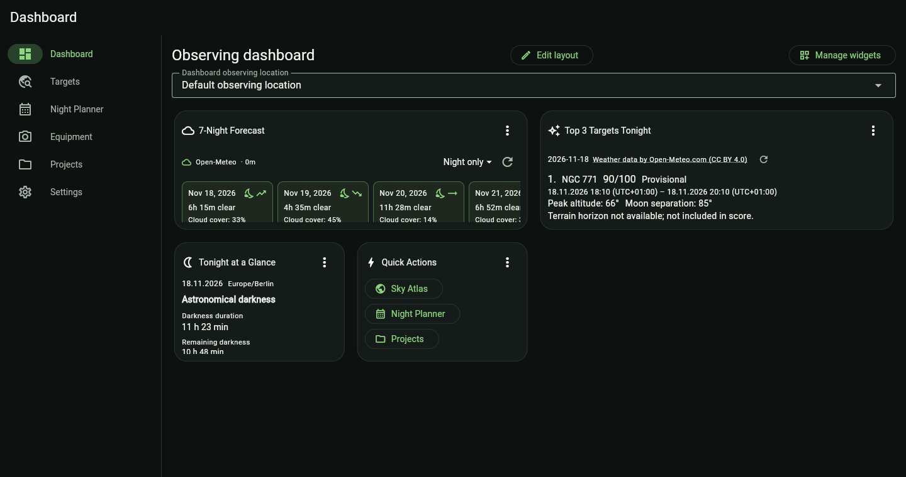

# AstroManager

AstroManager is an offline-first astrophotography planning application built with Flutter. It combines a local celestial-object catalog, observing-site and equipment management, nighttime planning, imaging projects, observation logs, and an interactive sky atlas. Weather forecasts, terrain profiles and observer-reported Bortle classes refine recommendations.

**Version** `1.0.0` (build `9`) · [Deutsch](docs/user-guide.de.md)



## What you can do

| Area | Features |
| --- | --- |
| **Targets** | Browse and search the bundled OpenNGC catalog; inspect object coordinates, visibility and observational details; open objects in the sky atlas. |
| **Sky atlas** | Explore DSS2 Color imagery in Aladin Lite; overlay local horizon, camera framing and saved multi-panel mosaic footprints. |
| **Night Planner** | Inspect sunset, sunrise, twilight, astronomical darkness, Moon conditions, target altitude and visibility; organize multiple project targets on an interactive timeline. |
| **Equipment** | Manage cameras, lenses, telescopes and mounts; build reusable optical setups and calculate field of view and image scale. |
| **Projects** | Organize targets, imaging goals, project status and integration-time targets; log sessions, exposure parameters, notes and optional images. Only accepted frames count toward usable integration time. |
| **Advanced planning** | Estimate terrain obstruction, record local sky darkness, compare observing locations and design/export mosaic panels. |
| **Settings and data** | Save observing sites and preferences, configure optional observation-opportunity alerts, and export/restore portable `.ambackup` files. |

The Dashboard offers locally saved, configurable widgets and quick actions.

## First observing night

1. Open **Settings → Observing Locations** and add a site with accurate coordinates, elevation and **IANA time zone** (for example `Europe/Zurich`). Make it the default site if appropriate.
2. In **Equipment**, add your camera, lens or telescope, mount and optical profile. Accurate sensor size and focal length are needed for framing and mosaics.
3. Find an object in **Targets**. Open its details or select **Sky Atlas** to inspect its framing against the selected setup.
4. Open **Night Planner**, select a site and observing date, and inspect the darkness and target-altitude timeline. Add project-linked observation blocks as needed.
5. Create an imaging goal in **Projects**; record each observing session, including exposure time and accepted/rejected frame counts. Watch accumulated integration time update.
6. Under **Settings → Backup & restore**, save an `.ambackup` copy of your data. Enable **Include session images** if you want attachments in that backup.

For screen-by-screen instructions, see the [English user guide](docs/user-guide.md) or the [German user guide](docs/user-guide.de.md).

## Language, first-run setup and accessibility

AstroManager supports English and German. Use **Settings → Application preferences → Language** to follow the device language or select English/Deutsch. The selection is saved offline. On the dashboard, the optional first-run guide introduces language selection, observing sites and equipment. You can skip it at any point and reopen it in Settings. No account is required, and location access is only requested if you explicitly select **Use current location**.

On phones, the sky atlas prioritizes the map. Expand the mobile control panel and open **Info → Use Aladin controls** to show or hide the embedded Aladin Lite buttons. On larger displays, the switch is also available above the atlas. AstroManager's own framing controls and source credits remain available independently. Embedded Aladin controls are hidden by default on narrow screens to prevent overlapping controls.

Native Flutter labels respect system text scaling and screen readers. Some dense plotting and third-party atlas content may still require zooming or direct interaction; verify your device's accessibility settings before observing.

## Offline and online features

- **Available locally:** bundled target catalog, saved sites/equipment/projects/sessions, astronomical calculations, mosaic geometry, observation plans and cached information.
- **Web startup:** the app and its bundled renderer load from the deployment origin. Reloading while that origin is unreachable depends on the deployment and browser cache.
- **Requires network access when fetching new data:** Open-Meteo forecasts, terrain heights via OpenTopoData and Aladin Lite's external viewer/survey imagery.
- **Not a guaranteed forecast or line-of-sight tool:** forecasts can be outdated and DEM horizons omit nearby buildings and trees.
- **Notifications:** optional on Android/iOS, evaluated on app launch, foreground resume or manual check. AstroManager does **not** guarantee continuous background weather monitoring.

See [Data sources and limitations](docs/data-sources.md) for credits, source conditions and scientific limitations.

## Platforms and installation

AstroManager targets Android, iOS, Web, Windows and macOS. The [installation and platform guide](docs/installation.md) lists the requirements, install steps and feature availability. Versioned downloads are listed under [GitHub Releases](https://github.com/CodefrogCF/AstroManager/releases).

## Build from source

Install Flutter `3.47.0` as pinned in [`.fvmrc`](.fvmrc), and the required tools for your target platform.

```bash
git clone https://github.com/CodefrogCF/AstroManager.git
cd AstroManager
flutter pub get --enforce-lockfile
flutter gen-l10n
flutter run -d chrome
```

For other configured platforms, select a connected device with `flutter devices` and use `flutter run -d <device-id>`. Generated Drift files are already included in the repository; regenerate them after schema changes with `dart run build_runner build --delete-conflicting-outputs`.

See the [release build instructions](docs/releasing.md) and [contribution guide](CONTRIBUTING.md) for platform toolchains, verification and signing.

## Documentation

- [English user guide](docs/user-guide.md) and [German user guide](docs/user-guide.de.md)
- [Installation and supported platforms](docs/installation.md)
- [Screenshots](docs/screenshots/README.md)
- [Architecture and development](docs/architecture.md)
- [Data sources and limitations](docs/data-sources.md)
- [Privacy and network requests](docs/privacy.md)
- [Backup format](docs/backup-format.md)
- [Changelog](CHANGELOG.md), [v1.0.0 release notes](docs/release-notes/v1.0.0.md) and [roadmap](ROADMAP.md)

## Data

AstroManager stores planning records locally. Weather requests can run automatically for the selected site. [Privacy and network requests](docs/privacy.md) explains what each provider receives.

## License

AstroManager is licensed under the Apache License, Version 2.0.
See [LICENSE](LICENSE).

Third-party libraries and datasets retain their respective licenses.
See [Third-Party Notices](docs/THIRD_PARTY_NOTICES.md).
