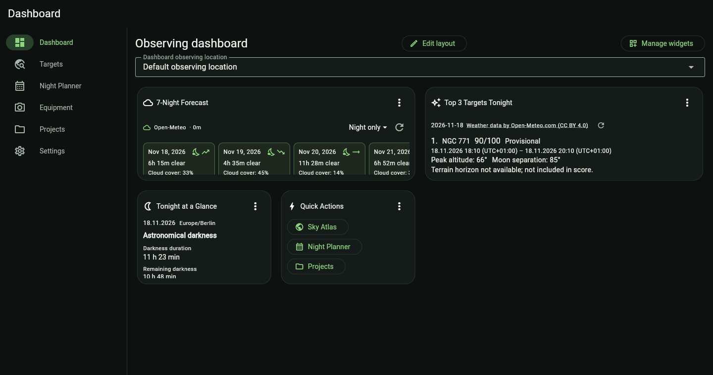
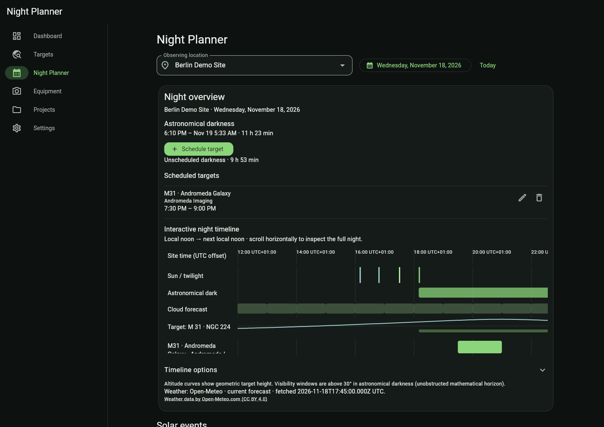
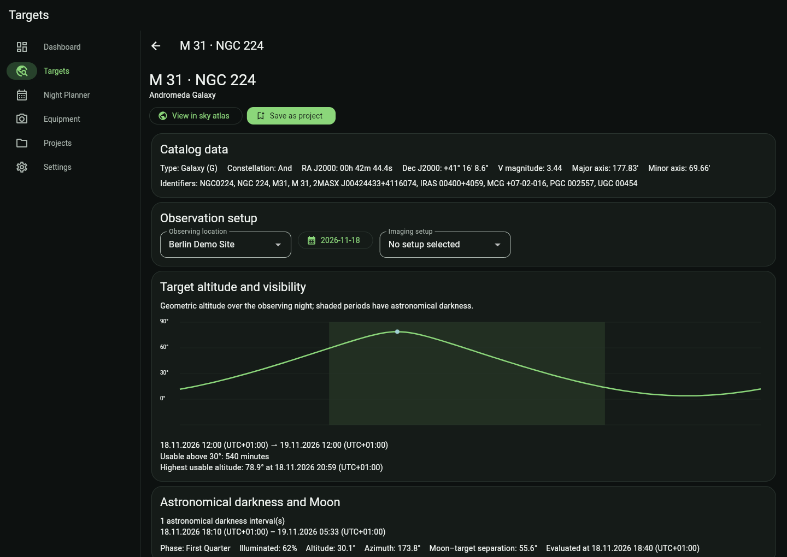

# AstroManager v1.0.0 screenshots

These screenshots show the Web release build with a demonstration observing
site, project and forecast. The recorded times and weather describe the example.

## Dashboard

## Night Planner

## Target details

[English user guide](../user-guide.md) · [Deutsche Anleitung](../user-guide.de.md)
